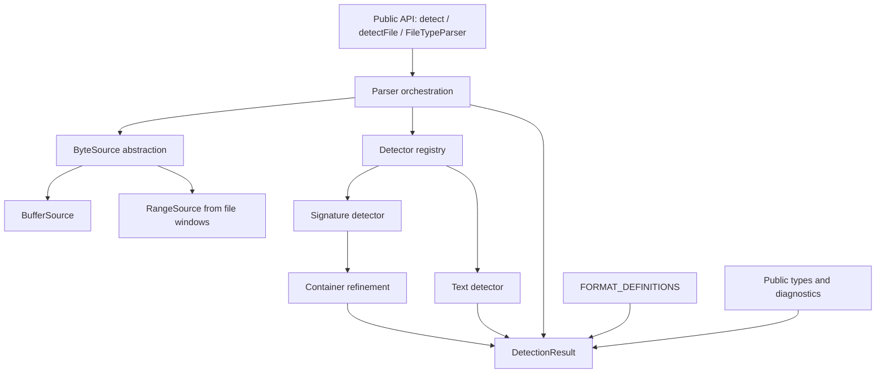

# Architecture

English | [简体中文](zh-CN/architecture.md)

## Goals and boundaries

The component is a content-first file type detector for Node.js 20 and later. It is distributed as a TypeScript-authored ESM package and has no runtime dependency on `libmagic`, native DLLs, external commands, decompression programs, or format-specific parsers.

The detector answers “what does this byte content look like?” It does not validate that a file is semantically complete, repair damaged files, unpack archives, execute scripts, render documents, or inspect macro behavior. A caller that needs those operations must add a separate, format-specific stage after detection.

The file name is an optional weak hint for inconclusive text input. A renamed binary file does not become another type because the name is never used to override a content signature.

## Public surface

The package root exports the following runtime functions and types:

```ts
import {
  detect,
  detectFile,
  getFormatByExtension,
  FileTypeParser,
} from 'xiaodao-filetype-parser';

const fromBuffer = detect(buffer, {
  fileName: 'upload.bin',
  includeSignals: true,
});

const fromFile = await detectFile('/data/upload.bin', {
  headBytes: 64 * 1024,
  tailBytes: 128 * 1024,
  maxReadBytes: 2 * 1024 * 1024,
});

const byExtension = getFormatByExtension('.DOCX');
```

`FileTypeParser` provides the same operations as instance methods and accepts defaults in its constructor. `detect` consumes a `Buffer` or `Uint8Array` and examines the supplied bytes. `detectFile` opens a regular file and materializes only the bounded ranges needed by the detector. `getFormatByExtension` is a metadata lookup; it is not a substitute for content detection.

## Layers



The parser layer normalizes input, merges options, creates a source, invokes the registry, and joins the selected candidate with `FORMAT_DEFINITIONS`. Detectors return candidates rather than public results. This keeps recognition rules small and lets the parser apply the stable result shape, metadata, and diagnostics consistently.

`ByteSource` exposes the source size, the number of covered bytes, a read-budget flag, and exact range reads. `BufferSource` represents an already materialized buffer. `RangeSource` represents disjoint head, tail, and ZIP-directory ranges from a file. The detector can therefore request bytes by offset without receiving a file handle or reading outside the prepared windows.

## Candidate and result model

Each detector candidate carries a `FileTypeId`, confidence from `0` to `1`, an authority flag, and one or more `DetectionSignal` records. A signal records its source (`signature`, `text`, `container`, `bom`, or `filename`), rule ID, offset when meaningful, and a human-readable detail.

The parser combines the candidate with the selected format definition and returns:

- stable `type`, display metadata, MIME type, extensions, category, and text/binary information;
- `encoding`, `confidence`, and `authoritative` status;
- `sizeBytes` and `bytesExamined` for bounded-read observability;
- explainability `signals` and non-fatal `diagnostics`;
- optional `container` information for ZIP, OLE, and RIFF inputs.

`unknown` is a valid result. Empty input, insufficient inspection data, and a safe refinement skip are represented in diagnostics instead of being converted into exceptions. Exceptions are reserved for invalid arguments, invalid read options, permission failures, and file read failures.

## Detector responsibilities

`signatures.ts` owns fixed and structured binary markers such as PNG, JPEG, PDF, media headers, archive magic, executable headers, and database headers. `text.ts` owns BOM detection, encoding clues, shebangs, structural text checks, JSON, XML, HTML, SVG, CSV, INI, EML, and filename hints for text formats. `containers.ts` refines generic ZIP, OLE, and RIFF candidates by reading safe metadata; it does not decompress entries or parse document bodies.

The registry is deliberately small: it tries the signature detector first, refines a binary container when appropriate, and falls back to the text detector only when no signature matches. This order gives strong content evidence priority over a filename hint and makes rule ownership explicit.

## Safety and resource boundaries

The library never executes the detected file, invokes a shell, loads native code, or decompresses archive members. File detection uses configurable positive integer limits. The default file windows are a 64 KiB head, a 128 KiB tail, and a 2 MiB total read budget. ZIP central-directory inspection is capped at 2 MiB; OLE refinement requires a complete source and is skipped when the bounded source cannot provide it.

The limits make detection suitable for untrusted upload paths, but they do not make a file safe to open or render. Consumers must still apply their own storage, malware scanning, decompression, and content validation policies.

## Adding a detector

1. Add or confirm a `FileTypeId` in `src/types.ts`.
2. Add its complete `FormatDefinition` in `src/formats.ts`, including the canonical MIME type and every supported extension alias.
3. Add the narrowest reliable rule to `signatures.ts`, `text.ts`, or `containers.ts`.
4. Return a signal that explains the evidence and choose `authoritative` only when the evidence is strong enough to stand on its own.
5. Add a real fixture and assertions for both `detect` and `detectFile` where the format can be represented safely.
6. Extend metadata and package checks when the public contract changes, then run `npm run check` and `npm run pack:check`.

Rules should be bounded, deterministic, and safe on truncated input. A rule that requires full parsing, decompression, execution, or a large unbounded read belongs in a downstream component.
