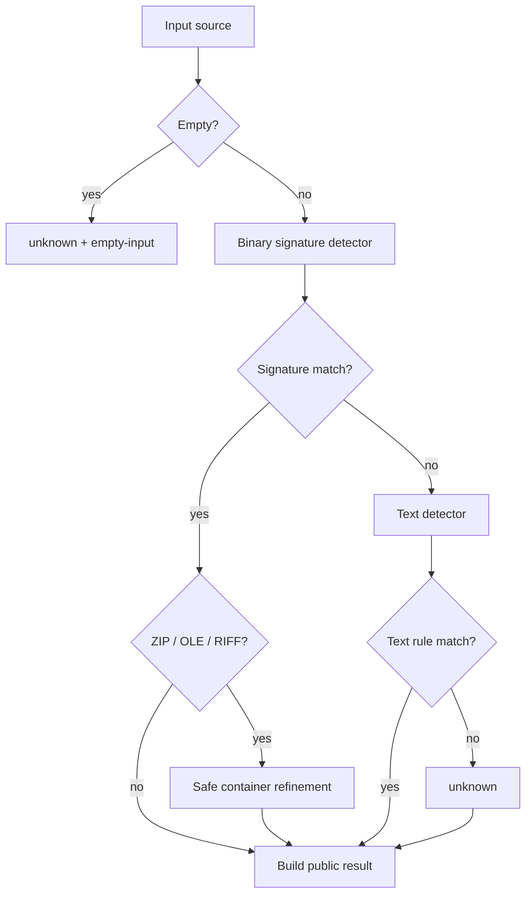

# Detection Pipeline

English | [简体中文](zh-CN/detection-pipeline.md)

## Entry points and option precedence

`detect(buffer, options)` is the in-memory path. The supplied `Buffer` or `Uint8Array` is normalized to a `BufferSource`, so the whole supplied input is available to the detectors and `bytesExamined` equals its length.

`detectFile(filePath, options)` is the bounded file path. It opens a regular file, records its size, loads the configured windows, closes the handle, and then runs the same detector pipeline against a detached `RangeSource`.

Options are merged in this order:

```text
call option > FileTypeParser constructor default > built-in default
```

The defaults are:

| Option | Default | Purpose |
| --- | ---: | --- |
| `headBytes` | 64 KiB | Initial range from offset zero. |
| `tailBytes` | 128 KiB | Final range for footers and ZIP directory discovery. |
| `maxReadBytes` | 2 MiB | Total file bytes that may be loaded. |
| text sniff limit | 64 KiB | Maximum head range considered by text rules. |
| ZIP directory limit | 2 MiB | Maximum central-directory bytes inspected. |

`useFileNameHint` and `includeSignals` default to `true`. A filename can be supplied explicitly for a buffer; `detectFile` derives the basename when the caller does not provide one.

## Preparing a file source

The file source first loads the head and tail ranges. It then searches the tail for the ZIP end-of-central-directory record. If the record points to a directory within the file and within the configured budget, that directory is loaded as a third range. The file handle is closed before recognition begins.

`RangeSource` never fills gaps implicitly. A read succeeds only when the requested range is fully covered by the prepared ranges. This makes a detector's data dependency visible: if it needs bytes outside the windows, the result is either less specific or carries a diagnostic.

`bytesExamined` is the size of the union of the covered ranges. Overlapping head, tail, and directory ranges are counted once. It describes available inspection coverage, not the number of system calls and not the number of bytes copied into a detector.

## Detector order



The signature detector runs first. It checks fixed markers and small structured headers for images, audio/video, archives, executables, databases, documents, and other binary formats. A signature candidate is sent to container refinement when it is a generic ZIP, OLE, or RIFF container.

The text detector runs only when no binary signature matches. It checks BOMs, BOM-less UTF-16 zero-byte patterns, UTF-8 validity, printable content, shebangs, XML/HTML/SVG structure, JSON parsing, RFC 5322 headers, CSV row consistency, and INI sections. A recognized text format can be authoritative when its structure is strong. Plain text and filename-derived text formats remain lower-confidence results.

## Content evidence and refinement

Container refinement reads metadata only:

- ZIP central-directory names identify DOCX, XLSX, PPTX, EPUB, JAR, APK, IPA, VSIX, and OpenDocument packages. A small stored `mimetype` entry can provide the OpenDocument subtype.
- OLE data is scanned for known stream names such as `WordDocument`, `Workbook`, `PowerPoint Document`, and the Outlook property stream used by MSG. The current OLE refinement needs a complete source and is skipped for an incomplete bounded source.
- RIFF subtypes distinguish WAVE, AVI, and WEBP. An unrecognized RIFF subtype remains the generic `riff` type.

No archive member is decompressed. ZIP refinement reads at most a small stored entry for the OpenDocument `mimetype` value and limits that value to 4096 bytes.

## Diagnostics and partial data

Diagnostics explain why a result may be incomplete:

| Code | Meaning |
| --- | --- |
| `empty-input` | The input has zero bytes. |
| `read-budget-exceeded` | The file budget prevented one or more requested ranges from loading. |
| `insufficient-data` | The available windows did not cover enough content to identify a non-empty file. |
| `container-refinement-skipped` | Container metadata was unavailable, incomplete, malformed, or outside a safe limit. |

The public diagnostic union also reserves `truncated-signature` for a signature rule that sees an incomplete structure and `ambiguous-result` for a rule that cannot distinguish compatible interpretations. The current built-in rules generally return no candidate or a lower-confidence candidate for those situations.

Recognition rules are written to return `null` or a lower-confidence candidate when bytes are missing. Truncated or malformed input should therefore produce a result with diagnostics rather than an uncaught parser exception. File opening and invalid option failures are different: they use `FileTypeError` with an error code such as `read-failed`, `permission-denied`, `invalid-input`, or `invalid-options`.

## Testing the pipeline

Pipeline tests should cover both source kinds and the evidence boundary:

1. Run a real fixture through `detect` with an unrelated filename to prove content recognition.
2. Run the same fixture through `detectFile` to exercise bounded windows and diagnostics.
3. Test renamed binary content to ensure the filename cannot override a signature.
4. Test text samples with and without BOMs, including UTF-16 patterns and structured formats.
5. Test truncated signatures, constrained read budgets, and malformed container directories.
6. Assert the public result fields, signals, confidence/authority expectations, and relevant diagnostics.

The repository's `npm run check` command builds TypeScript and runs the Node test suite. `npm run pack:check` additionally validates the published allowlist and packed metadata.
