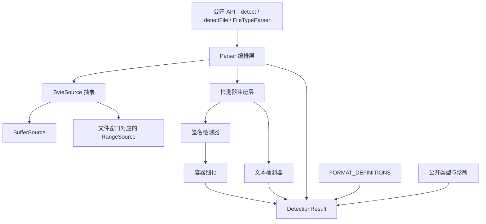

# 总体架构与设计决策

[English](../architecture.md) | 简体中文

## 目标与边界

组件面向 Node.js 20 及更高版本，按文件内容优先识别类型。项目使用 TypeScript 编写并以 ESM 包形式交付，运行时不依赖 `libmagic`、原生 DLL、外部命令、解压程序或具体格式解析器。

组件回答的是“这段字节内容最像什么类型”。它不负责判断文件是否语义完整，不修复损坏文件，不解压归档，不执行脚本，不渲染文档，也不分析宏行为。需要这些能力的调用方应在识别之后增加独立的格式处理阶段。

文件名只会在文本内容无法进一步判断时作为低权重提示。把二进制文件改名不会改变识别结果，因为文件名不会覆盖内容签名。

## 公开接口

包根目录导出以下运行时函数和类型：

```ts
import {
  detect,
  detectFile,
  getFormatByExtension,
  FileTypeParser,
} from 'xiaodao-filetype-parser';

const fromBuffer = detect(buffer, {
  fileName: 'upload.bin',
  includeSignals: true,
});

const fromFile = await detectFile('/data/upload.bin', {
  headBytes: 64 * 1024,
  tailBytes: 128 * 1024,
  maxReadBytes: 2 * 1024 * 1024,
});

const byExtension = getFormatByExtension('.DOCX');
```

`FileTypeParser` 以实例方法提供相同的检测操作，并可在构造函数中设置默认选项。`detect` 接收 `Buffer` 或 `Uint8Array`，识别调用方提供的字节。`detectFile` 打开普通文件，只读取检测所需的有界范围。`getFormatByExtension` 只查询格式元数据，不能替代内容识别。

## 分层结构



Parser 层负责规范化输入、合并选项、创建 source、调用检测器注册层，并把选中的 candidate 与 `FORMAT_DEFINITIONS` 合并。检测器返回 candidate，而不是直接构造公开结果，因此可以集中维护结果结构、格式元数据和诊断信息。

`ByteSource` 暴露源文件大小、已覆盖的字节数、读取预算状态以及按偏移读取的能力。`BufferSource` 表示已经完整载入的 Buffer。`RangeSource` 表示文件的头部、尾部和 ZIP 目录等不连续范围。这样检测规则可以按偏移读取字节，而不需要持有文件句柄，也不能越过预先准备的窗口。

## Candidate 与结果模型

每个 candidate 包含 `FileTypeId`、`0` 到 `1` 的置信度、权威性标志以及一个或多个 `DetectionSignal`。signal 记录证据来源（`signature`、`text`、`container`、`bom` 或 `filename`）、规则 ID、有意义时的偏移和可读说明。

Parser 将 candidate 与格式定义合并，返回：

- 稳定的 `type`、显示名称、说明、MIME、扩展名、类别和文本/二进制属性；
- `encoding`、`confidence` 和 `authoritative`；
- 用于观察有界读取的 `sizeBytes` 和 `bytesExamined`；
- 可解释的 `signals` 和非致命的 `diagnostics`；
- ZIP、OLE、RIFF 输入对应的可选 `container` 信息。

`unknown` 是合法结果。空输入、检查数据不足以及安全的容器细化跳过都会写入诊断，不会被转换成异常。异常只用于非法参数、非法读取选项、权限失败和文件读取失败。

## 检测器职责

`signatures.ts` 负责 PNG、JPEG、PDF、媒体头、归档魔数、可执行文件头和数据库头等固定或结构化二进制标记。`text.ts` 负责 BOM、编码线索、shebang、文本结构、JSON、XML、HTML、SVG、CSV、INI、EML，以及文本格式的文件名提示。`containers.ts` 通过安全的元数据读取细化通用 ZIP、OLE 和 RIFF candidate，不解压成员，也不解析文档正文。

注册层保持简单：先尝试签名检测器，必要时细化二进制容器；没有签名命中时再回退到文本检测器。这样的顺序让内容证据优先于文件名提示，也让规则归属清晰。

## 安全与资源边界

库不会执行被识别的文件，不调用 shell，不加载原生代码，也不解压归档成员。文件识别使用可配置的正整数限制。默认文件窗口为头部 64 KiB、尾部 128 KiB 和总读取预算 2 MiB。ZIP 中央目录最多检查 2 MiB；OLE 细化需要完整 source，当有界 source 无法提供完整内容时会跳过。

这些限制适合不可信上传路径，但不代表文件可以安全打开或渲染。调用方仍需自行负责存储策略、恶意文件扫描、解压限制和内容校验。

## 新增检测规则

1. 在 `src/types.ts` 增加或确认 `FileTypeId`。
2. 在 `src/formats.ts` 增加完整的 `FormatDefinition`，填写规范 MIME 和所有支持的扩展名别名。
3. 将最小且可靠的规则放入 `signatures.ts`、`text.ts` 或 `containers.ts`。
4. 返回能够说明证据的 signal；只有证据足够独立时才设置 `authoritative`。
5. 增加安全的真实样本，并同时覆盖 `detect` 与 `detectFile`。
6. 当公开契约发生变化时同步更新元数据和包检查，然后运行 `npm run check` 与 `npm run pack:check`。

规则应当有界、确定，并能安全处理截断输入。需要完整解析、解压、执行或大范围无界读取的能力应放在下游组件中。
