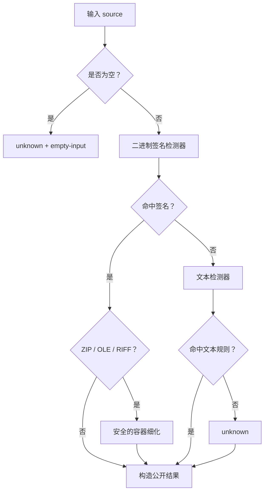

# 检测流程

[English](../detection-pipeline.md) | 简体中文

## 入口与选项优先级

`detect(buffer, options)` 是内存路径。传入的 `Buffer` 或 `Uint8Array` 会规范化为 `BufferSource`，因此整个输入都可供检测器使用，`bytesExamined` 等于输入长度。

`detectFile(filePath, options)` 是有界文件路径。它打开普通文件，记录文件大小，读取配置的窗口，关闭文件句柄，然后让同一套检测流程面对脱离句柄的 `RangeSource` 运行。

选项按以下顺序合并：

```text
调用参数 > FileTypeParser 构造函数默认值 > 内置默认值
```

内置默认值如下：

| 选项 | 默认值 | 作用 |
| --- | ---: | --- |
| `headBytes` | 64 KiB | 从偏移 0 开始读取的头部范围。 |
| `tailBytes` | 128 KiB | 用于读取文件尾和发现 ZIP 目录的尾部范围。 |
| `maxReadBytes` | 2 MiB | 文件最多载入的总字节数。 |
| 文本探测上限 | 64 KiB | 文本规则最多检查的头部范围。 |
| ZIP 目录上限 | 2 MiB | 最多检查的中央目录字节数。 |

`useFileNameHint` 和 `includeSignals` 默认都是 `true`。对 Buffer 输入可以显式提供文件名；对文件输入，如果调用方没有提供，`detectFile` 会使用路径的 basename。

## 准备文件 source

文件 source 先读取头部和尾部范围，然后在尾部搜索 ZIP end-of-central-directory 记录。如果记录指向文件内且预算允许的目录，就把该目录作为第三个范围读取。识别开始前文件句柄已经关闭。

`RangeSource` 不会自动填补范围之间的空洞。只有请求范围被准备好的数据完整覆盖时，读取才会成功。这样可以明确检测器依赖哪些数据：如果它需要窗口之外的字节，结果会降低具体程度，或写入诊断。

`bytesExamined` 是所有已覆盖范围的并集大小。头部、尾部和目录范围重叠时只计算一次。它描述可供检查的覆盖量，不代表系统调用次数，也不代表检测器内部复制的字节数。

## 检测器顺序



流程先运行签名检测器。它用固定魔数和小型结构头识别图片、音视频、归档、可执行文件、数据库、文档等二进制格式。若命中的是通用 ZIP、OLE 或 RIFF 容器，则进入容器细化。

只有没有二进制签名命中时才运行文本检测器。它依次检查 BOM、无 BOM 的 UTF-16 零字节模式、UTF-8 有效性、可打印内容、shebang、XML/HTML/SVG 结构、JSON 解析、RFC 5322 头、CSV 行一致性和 INI 段落。结构证据很强的文本格式可以标记为权威识别；普通文本和由文件名推导出的文本格式保持较低置信度。

## 内容证据与容器细化

容器细化只读取元数据：

- ZIP 中央目录的条目名可识别 DOCX、XLSX、PPTX、EPUB、JAR、APK、IPA、VSIX 和 OpenDocument 包。OpenDocument 的小型已存储 `mimetype` 条目还可以给出具体子类型。
- OLE 数据会查找 `WordDocument`、`Workbook`、`PowerPoint Document` 和 MSG 使用的 Outlook 属性流等已知流名称。当前 OLE 细化要求完整 source；有界 source 不完整时会跳过。
- RIFF 子类型可区分 WAVE、AVI 和 WEBP。未识别的 RIFF 子类型保留为通用 `riff`。

流程不会解压归档成员。ZIP 细化最多读取一个小型已存储条目来获取 OpenDocument 的 `mimetype`，且该值最多读取 4096 字节。

## 诊断与部分数据

诊断用于解释结果为什么可能不完整：

| 代码 | 含义 |
| --- | --- |
| `empty-input` | 输入长度为零。 |
| `read-budget-exceeded` | 文件读取预算阻止了一个或多个范围载入。 |
| `insufficient-data` | 已有窗口不足以识别非空文件。 |
| `container-refinement-skipped` | 容器元数据不可用、不完整、格式错误或超出安全上限。 |

公开诊断联合类型还为 `truncated-signature`（签名规则发现结构不完整）和 `ambiguous-result`（规则无法区分兼容解释）保留了代码。当前内置规则遇到这些情况时通常返回空 candidate 或降低置信度。

规则在数据缺失时应返回 `null` 或较低置信度的 candidate。因此截断或格式错误的输入应返回带诊断的结果，而不是抛出未捕获的解析异常。文件打开失败和选项非法属于另一类错误，会通过 `FileTypeError` 返回 `read-failed`、`permission-denied`、`invalid-input` 或 `invalid-options` 等错误码。

## 流程测试

流程测试应覆盖两类 source 和证据边界：

1. 使用无关文件名把真实样本传给 `detect`，证明识别依赖内容。
2. 把同一样本传给 `detectFile`，覆盖有界窗口和诊断。
3. 测试改名后的二进制内容，确保文件名不能覆盖签名。
4. 测试有 BOM、无 BOM 的文本，包括 UTF-16 模式和结构化文本。
5. 测试截断签名、受限读取预算和错误的容器目录。
6. 断言公开结果字段、signals、置信度/权威性以及相关诊断。

仓库的 `npm run check` 会编译 TypeScript 并运行 Node 测试套件；`npm run pack:check` 还会校验发布白名单和打包元数据。
